## Shirone 创作与使用指南

欢迎来到 **Shirone**（白音）——一款富有表现力、受动漫启发的博客主题，基于 **Astro 7**、**Svelte 5** 与 **Material 3 Expressive (M3E)** 设计系统打造。

本指南将带你了解文章创建、frontmatter 规范、目录结构，以及完整的内置 Markdown 与 MDX 扩展。

:::tip
Shirone 优先在服务端渲染内容（SSR-first）。站内导航时，Swup 会无缝替换主容器，同时保留外层应用外壳与持续的音乐播放。
:::

---

## 1. 创建新文章

你可以使用内置的 CLI 命令快速生成一篇带标准 frontmatter 的新文章：

```bash
# Create a single-file post
pnpm new-post my-first-post

# Or create a post in a sub-directory
pnpm new-post guides/getting-started
```

新创建的文件会放在 `src/content/posts/` 目录下。

---

## 2. Frontmatter 规范

每篇 Markdown（`.md`）或 MDX（`.mdx`）文章都以一段 YAML frontmatter 块开头，用来定义其元数据。

### 示例

```yaml
---
title: "Exploring Material 3 Expressive Design"
published: 2026-08-26
updated: 2026-08-27
publishedAt: 2026-08-26T10:00:00+08:00
updatedAt: 2026-08-27T09:30:00+08:00
pinned: true
description: "A deep dive into dynamic HCT color science and fluid transitions in Shirone."
image: "./cover.webp"
tags: [M3E, Design, Frontend]
category: Guides
draft: false
comment: true
---
```

### 支持的 Frontmatter 字段

| 字段 | 类型 | 必填 | 说明 |
| :--- | :--- | :---: | :--- |
| `title` | `string` | **是** | 文章主标题。 |
| `published` | `Date` | **是** | 发布日期，`YYYY-MM-DD` 格式。 |
| `publishedAt` | `Date` | 否 | 用于给同一天发布的文章排序的精确发布时间，必须落在配置站点时区中的 `published` 当天。 |
| `updated` | `Date` | 否 | 最后更新日期。提供后会显示更新提示徽标。 |
| `updatedAt` | `Date` | 否 | 供订阅源与机器可读元数据使用的精确更新时间，必须与 `updated` 配对。 |
| `pinned` | `boolean` | 否 | 将文章置顶到文章列表顶部（默认：`false`）。 |
| `description` | `string` | 否 | 显示在文章卡片、搜索结果与 OpenGraph 元数据中的文章摘要。 |
| `image` | `string` | 否 | 封面图路径。支持相对路径（`./cover.webp`）、public（`/images/cover.jpg`）或远程 URL。 |
| `tags` | `string[]` | 否 | 用于分类筛选与标签云的标签名数组。 |
| `category` | `string` | 否 | 用于分类索引的主分类名。 |
| `draft` | `boolean` | 否 | 标记为草稿。草稿文章在生产构建（`pnpm build`）时隐藏。 |
| `comment` | `boolean` | 否 | 为该文章开启/关闭评论区（默认：`true`）。 |
| `lang` | `string` | 否 | 语言代码（如 `en`、`zh_CN`、`ja`），若与站点默认不同。 |

---

## 3. 文章加密

Shirone 提供客户端文章加密。这是一个静态密码门，而非服务端访问控制：加密载荷与资源 URL 仍然可被公开下载，因此不要用于真正机密的文件或受监管的机密。对于私人日记或受限文章，可在 frontmatter 中指定密码：

```yaml
---
title: "Private Research Notes"
published: 2026-08-26
encrypted: true
password: "your-secret-passphrase"
passwordHint: "Favorite anime character"
hideHomeContent: true
---
```

- `encrypted`：设为 `true` 以启用加密；
- `password`：解锁文章所需的密码字符串或数字；
- `passwordHint`：显示在密码输入框上方的可选提示；
- `hideHomeContent`：在首页隐藏字数与内容预览，防止数据泄露。

---

## 4. 组织文章文件

Shirone 同时支持基于文件夹的同置布局与单文件布局：

### 文件夹结构（推荐用于本地资源）

将文章与其媒体文件放在一起，能让资源管理更直观：

```text
src/content/posts/
├── my-great-post/
│   ├── index.md           <-- Post content
│   ├── cover.webp         <-- Cover image (image: "./cover.webp")
│   └── diagram.png        <-- Inline illustration referenced in markdown
```

### 单文件结构（轻量纯文本）

```text
src/content/posts/
├── hello-world.md
└── quick-thoughts.md
```

---

## 5. 丰富的 Markdown 与 MDX 扩展

Shirone 开箱即用地内置了现代 Markdown 扩展：

### 5.1 提示框（Admonitions）

使用容器指令来标注笔记、提示、警告与提醒：

```markdown
:::tip
Use admonition containers to highlight key takeaways or best practices.
:::

:::warning
Use warning containers to signal potential pitfalls or breaking changes.
:::
```

### 5.2 GitHub 仓库卡片

使用指令语法嵌入实时、样式精美的 GitHub 仓库卡片：

```markdown
::github{repo="LyraVoid/Shirone"}
```

::github{repo="LyraVoid/Shirone"}

### 5.3 Expressive 代码块

增强型代码块支持语法高亮、文件名徽标、行号以及选择性行高亮：

```typescript title="src/utils/theme.ts" {2,4-5}
// Dynamic HCT color token derivation
import { argbFromHex, themeFromSourceColor } from "@material/material-color-utilities";

const theme = themeFromSourceColor(argbFromHex("#f472b6"));
console.log("Primary color token:", theme.schemes.light.primary);
```

### 5.4 数学排版（KaTeX）

直接在 Markdown 中渲染优雅的 LaTeX 数学公式：

- **行内公式**：$E = mc^2$ 或欧拉公式 $e^{i\pi} + 1 = 0$。
- **块级公式**：

$$
\int_{-\infty}^{\infty} e^{-x^2} \, dx = \sqrt{\pi}
$$

### 5.5 Mermaid 图表

使用纯文本创建流程图、时序图与架构图：

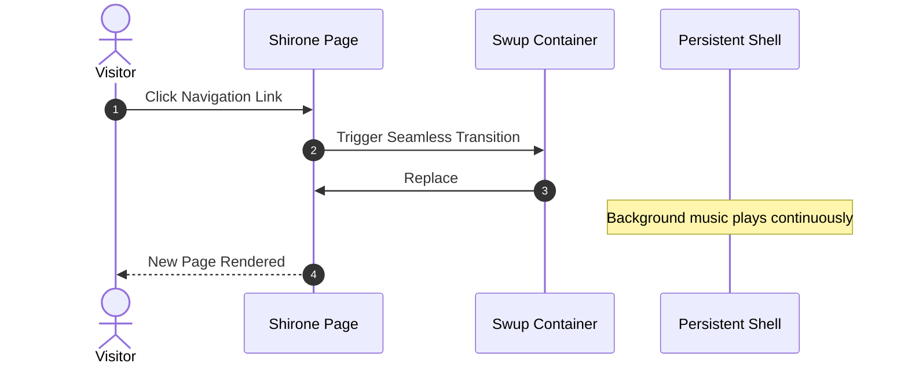

### 5.6 图片画廊与 Fancybox 灯箱

图片会自动与 Fancybox 集成，支持无损缩放、平移手势与全屏预览：

```markdown

```

---

## 6. 后续步骤与自定义

- **站点配置**：在 `src/config/siteConfig.ts` 与 [`src/config/README.md`](https://github.com/LyraVoid/Shirone/blob/main/src/config/README.md) 中了解全局设置。
- **设计令牌**：在 `DESIGN.md` 与 `docs/m3e-standard.md` 中探索令牌与调色板。
- **反馈与社区**：在 [GitHub Issues](https://github.com/LyraVoid/Shirone/issues) 分享你的想法与问题。

---

## markdown.md

# 一个 h1 标题

段落之间用空行分隔。

第二段。_斜体_、**粗体**，以及 `monospace`。项目列表
看起来像：

- 这个
- 那个
- 还有那一个

请注意 —— 不考虑星号 —— 实际文本
内容从第 4 列开始。

> 块引用就像
> 这样书写。
>
> 它们可以跨多个段落，
> 如果你愿意的话。

使用 3 个连字符表示长破折号。使用 2 个连字符表示范围（例如，"it's all
in chapters 12--14"）。三个点 ... 会被转换为省略号。
支持 Unicode。☺

## 一个 h2 标题

这是一个有序列表：

1. 第一项
2. 第二项
3. 第三项

再次注意，实际文本如何从第 4 列开始（距离左侧 4 个字符）。
这里是一个代码示例：

    # Let me re-iterate ...
    for i in 1 .. 10 { do-something(i) }

正如你可能猜到的，缩进了 4 个空格。顺便说一句，如果你愿意的话，
除了缩进代码块，你也可以使用分隔代码块：

```
define foobar() {
    print "Welcome to flavor country!";
}
```

（这使得复制和粘贴更容易）。你可以选择性地标记
分隔代码块，让 Pandoc 对其进行语法高亮：

```python
import time
# Quick, count to ten!
for i in range(10):
    # (but not *too* quick)
    time.sleep(0.5)
    print i
```

### 一个 h3 标题

现在是一个嵌套列表：

1. 首先，准备好这些食材：

    - 胡萝卜
    - 芹菜
    - 小扁豆

2. 烧一些水。

3. 把所有东西倒进锅里，然后按照
    这个算法操作：

        find wooden spoon
        uncover pot
        stir
        cover pot
        balance wooden spoon precariously on pot handle
        wait 10 minutes
        goto first step (or shut off burner when done)

    不要碰到木勺，否则它会掉下来。

再次注意，文本总是对齐在 4 空格缩进上（包括
上面续接第 3 项的最后一行）。

这里有一个指向 [某个网站](http://foo.bar) 的链接、指向 [本地
文档](local-doc.html) 的链接，以及指向 [当前文档中的某个章节标题](#an-h2-header)
的链接。这里有一个脚注 [^1]。

[^1]: 脚注文本放在这里。

表格可以看起来像这样：

尺码 材质 颜色

---

9 皮革 棕色
10 麻帆布 本色
11 玻璃 透明

Table: 鞋子、它们的尺码，以及它们的材质

（上面是表格的标题。）Pandoc 还支持
多行表格：

---

关键词 文本

---

红色 日落、苹果，以及
其他红色或偏红的
事物。

绿色 树叶、草、青蛙，
以及其他不容易"成为"的
事物。

---

接下来是一条水平分割线。

---

这里是一个定义列表：

apples
: 很适合用来做苹果酱。
oranges
: 柑橘类水果！
tomatoes
: "tomatoe" 里没有 "e"。

同样，文本缩进了 4 个空格。（在每个术语/定义对之间放一个空行，
可以让它们更分散。）

这里是一个"行块"：

| 第一行
| 第二行
| 第三行

图片可以像这样指定：

[//]: # (![example image]&#40;./demo-banner.png "An exemplary image"&#41;)

行内数学公式像这样书写：$\omega = d\phi / dt$。块级
数学公式应该独占一行，并用双美元符号包裹：

$$I = \int \rho R^{2} dV$$

$$
\begin{equation*}
\pi
=3.1415926535
 \;8979323846\;2643383279\;5028841971\;6939937510\;5820974944
 \;5923078164\;0628620899\;8628034825\;3421170679\;\ldots
\end{equation*}
$$

另外请注意，你可以反斜杠转义任何希望原样显示的标点
字符，例如：\`foo\`、\*bar\* 等。

---

## markdown-enhancements.md

Shirone 提供了一系列主题专属的 Markdown 扩展和自定义语法容器。它们构建在我们原生的 unified AST 处理管道之上，所有扩展都会在站点构建期间渲染成可访问的、语义化的 HTML，实现**零客户端 JavaScript 水合开销**和 **100% 的 M3E 设计令牌对齐**。

## 文件树

文件树将多级项目结构、源码层级以及终端目录输出转换成紧凑、可交互的树形视图，并自动附带扩展名图标、差异高亮以及可折叠的分支。

### 1. 嵌套列表语法（`:::file-tree`）

当你要直接将文件层级写成 Markdown 嵌套列表时，请使用 `:::file-tree` 块指令。

```markdown
:::file-tree{title="Shirone source tree"}
- src
  - components/
    - ++ Navigation.svelte # added component
    - -- Button.astro # removed component
  - content
    - posts/
      - markdown-enhancements.md
  - layouts/
    - PostLayout.astro
  - plugins
    - markdown/
      - rehype-file-tree.mjs
  - styles
    - markdown/
      - trees.css
  - **content.config.ts** # important file
- public/
  - favicon.svg
- package.json
:::
```

:::file-tree{title="Shirone source tree"}
- src
  - components/
    - ++ Navigation.svelte # added component
    - -- Button.astro # removed component
  - content
    - posts/
      - markdown-enhancements.md
  - layouts/
    - PostLayout.astro
  - plugins
    - markdown/
      - rehype-file-tree.mjs
  - styles
    - markdown/
      - trees.css
  - **content.config.ts** # important file
- public/
  - favicon.svg
- package.json
:::

#### 编写规则与标记

- **差异状态**：在条目前面加上 `++`（绿色背景和徽标）或 `--`（红色背景和删除线）来高亮变更。
- **注释**：任何跟在 `#` 后面的文本都会渲染成柔和的、右对齐的行内注释。
- **强调**：用 `**粗体**` 包裹文件名，让关键文件获得突出的视觉权重。
- **可折叠文件夹**：从嵌套列表条目推断出的目录默认展开。添加尾部斜杠（例如 `components/`）可创建折叠目录，读者可通过点击或键盘导航将其展开。

---

### 2. 终端输出语法（```` ```file-tree ````）

当你已经拥有由 `tree` 等命令行工具生成的目录树文本时，可以直接将其粘贴到 `file-tree` 围栏代码块中。Unicode 分支字符（`├──`、`└──`、`│`）和 ASCII 分支都会被自动解析。

````markdown
```file-tree title="Build output" icon="simple"
dist
├── _astro/
│   ├── index.css
│   └── page.js
└── favicon.ico
```
````

```file-tree title="Build output" icon="simple"
dist
├── _astro/
│   ├── index.css
│   └── page.js
└── favicon.ico
```

#### 配置选项

- `title="string"`：为树设置自定义标题和无障碍标签。
- `icon="colored" | "simple"`：在多彩扩展名图标（`colored`，默认）或极简单色图标（`simple`）之间选择。

---

## 代码树

交互式代码树将左侧的多级文件层级导航面板与右侧即时切换的代码面板配对。它为多文件示例、模块或整个目录的浏览提供类似 IDE 的阅读体验。

### 1. 容器语法（`:::code-tree`）

在 `:::code-tree` 块指令中组合多个围栏代码块。每个代码块通过 `title="path/to/file"` 指定其路径。

````markdown
:::code-tree{title="Shirone Component Demo" height="380px" entry="src/Button.svelte"}
```svelte title="src/Button.svelte"
<script lang="ts">
  let { label = "Click me" } = $props();
</script>

<button class="m3-btn">{label}</button>
```

```stylus title="src/styles/button.styl"
.m3-btn
  background: var(--primary)
  color: var(--on-primary)
  border-radius: var(--shape-corner-m)
```

```json title="package.json"
{
  "name": "button-demo",
  "version": "1.0.0"
}
```
:::
````

:::code-tree{title="Shirone Component Demo" height="380px" entry="src/Button.svelte"}
```svelte title="src/Button.svelte"
<script lang="ts">
  let { label = "Click me" } = $props();
</script>

<button class="m3-btn">{label}</button>
```

```stylus title="src/styles/button.styl"
.m3-btn
  background: var(--primary)
  color: var(--on-primary)
  border-radius: var(--shape-corner-m)
```

```json title="package.json"
{
  "name": "button-demo",
  "version": "1.0.0"
}
```
:::

#### 配置与标记

- `title="string"`：设置代码树的标题和无障碍标签。
- `height="string"`：设置桌面视图的高度（默认 `420px`，例如 `380px`、`26rem`）。
- `entry="filepath"`：指定首次加载时激活的文件。
- `icon="colored" | "simple"`：在彩色或极简单色文件图标之间切换。
- `:active`：在任意围栏代码块上放置 `:active`，将其指定为默认激活的标签页。

---

### 2. 本地目录自动导入（`@[code-tree]`）

直接指向工作区中的任意本地目录路径，即可在构建时自动扫描并生成交互式代码树，而无需手动复制文件内容。

```markdown
@[code-tree title="Anime Utilities" entry="status.ts"](/src/utils/anime)
```

@[code-tree title="Site Configuration" entry="siteConfig.ts"](/src/config)

---

## markdown-extended.md

## GitHub 仓库卡片
你可以添加链接到 GitHub 仓库的动态卡片，在页面加载时，仓库信息会从 GitHub API 拉取。

::github{repo="Fabrizz/MMM-OnSpotify"}

使用代码 `::github{repo="<owner>/<repo>"}` 创建 GitHub 仓库卡片。

```markdown
::github{repo="saicaca/fuwari"}
```

## Mermaid 图表

围栏 `mermaid` 代码块会渲染为图表，并遵循当前激活的配色方案。

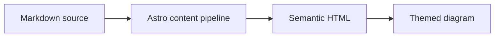

## 提示框

支持以下类型的提示框：`note` `tip` `important` `warning` `caution`

:::note
高亮那些用户即使快速浏览也应该留意的信息。
:::

:::tip
帮助用户取得更好效果的可选信息。
:::

:::important
用户成功所必需的关键信息。
:::

:::warning
由于潜在风险而需要用户立即关注的关键内容。
:::

:::caution
某个操作可能带来的负面后果。
:::

### 基本语法

```markdown
:::note
Highlights information that users should take into account, even when skimming.
:::

:::tip
Optional information to help a user be more successful.
:::
```

### 自定义标题

提示框的标题可以自定义。

:::note[我的自定义标题]
这是一个带自定义标题的提示框。
:::

```markdown
:::note[MY CUSTOM TITLE]
This is a note with a custom title.
:::
```

### GitHub 语法

> [!TIP]
> [GitHub 语法](https://github.com/orgs/community/discussions/16925) 同样受支持。

```
> [!NOTE]
> The GitHub syntax is also supported.

> [!TIP]
> The GitHub syntax is also supported.
```

### 剧透（Spoiler）

你可以为文本添加剧透遮罩。该文本同样支持 **Markdown** 语法。

内容 :spoiler[被隐藏了 **ayyy**]！

```markdown
The content :spoiler[is hidden **ayyy**]!

```

## 图片宽度与标题

独立图片可以在其 alt 文本中接受一个可选的 `w-N%` 宽度令牌，并使用一个渲染在图片下方居中显示的 Markdown 标题作为说明：


```markdown

```

有效宽度范围从 `w-1%` 到 `w-100%`；无效令牌会保留在 alt 文本中。宽度和标题相互独立 —— 仅提供标题也会生成说明：


---

## markdown-fields.md

当多个相关选项属于同一 API 或组件时，请使用 `field-group`。把字段名放在开头一行，然后在描述之前添加元数据标签。

:::: field-group

::: field tex
@type object
@optional

TeX 解析器选项。
:::

::: field output
@type `'svg' | 'chtml'`
@default `'svg'`
@optional

输出格式，SVG 或通用 HTML。
:::

::::

## 基本字段

必填、可选和已弃用三种状态可以混合在同一个组中。默认值与类型分开存放，便于快速扫读。

:::: field-group

::: field title
@type string
@required

组件的可见标题。该值会显示在页面标题中，应当足够简短，便于快速扫读。
:::

::: field disabled
@type boolean
@default `false`
@optional

控件是否以禁用状态启动。
:::

::: field locale
@type `'en' | 'zh-CN' | 'ja-JP'`
@default `'en'`
@optional

用于格式化日期、数字和无障碍标签的语言环境。
:::

::::

## 富文本描述

描述就是普通的 Markdown。在元数据行之后，链接、强调、列表和行内代码仍然可用。

:::: field-group

::: field render
@type `(value: unknown) => string`
@required

将值渲染为最终输出。回调应返回一个**安全字符串**，并且可以使用 `formatValue` 辅助函数。

- 保持渲染具有确定性。
- 避免在回调内发起网络请求。
:::

::: field retries
@type number
@default `3`
@optional

在请求被报告为失败之前，最大尝试次数。
:::

::: field legacyMode
@type boolean
@deprecated

为向后兼容而保留。新的集成应改用 `compatibility`。
:::

::::

## 独立字段

当需要在示例或代码块旁边记录单个选项时，可以不使用组，单独使用一个字段。

::: field format
@type `'short' | 'long'`
@default `'short'`
@optional

控制结果的格式化方式。
:::

## 编写说明

- `@type` 和 `@default` 的值会渲染为代码令牌。
- `@required`、`@optional` 和 `@deprecated` 会添加一个状态徽标。
- 元数据之后的任何普通 Markdown 都会成为字段描述。
- 未知的 `@tags` 会作为描述文本保留可见，而不会被丢弃。

---

## markdown-abbreviations.md

缩写让技术写作保持紧凑，同时为有需要的读者保留完整的术语。已定义的术语会渲染为原生的 `abbr` 元素，其含义可在悬停时查看，并可供辅助技术获取。

## 在上下文中

SSR 优先的输出在 JavaScript 运行之前就让初始文档可见。在衡量其阅读体验时，LCP 和 CLS 可以揭示首个可见内容是否快速且稳定。

缩写也可以出现在 **SSR** 指南这类普通 Markdown 旁边，但诸如 `SSR` 这样的字面代码以及 [LCP 文档](https://web.dev/articles/lcp) 之类的链接则保持不变。

## 定义术语

可以在同一份 Markdown 文档的任意位置放置定义。它们不会渲染为可见段落，只有该文章中匹配的术语才会获得语义化的缩写处理。

```markdown
*[SSR]: Server-Side Rendering
*[LCP]: Largest Contentful Paint
*[CLS]: Cumulative Layout Shift

SSR makes an HTML response available before client code runs.
```

*[SSR]: Server-Side Rendering
*[LCP]: Largest Contentful Paint
*[CLS]: Cumulative Layout Shift

## 编写边界

术语必须以字母或数字开头，并且可以包含字母、数字、句点、下划线、加号和连字符。每个定义仅适用于当前文章；无效或重复的定义仍保持普通 Markdown，而不会静默替换其他术语。

---

## Markdown 文件包含

Shirone 可以包含一个本地 Markdown 文件，或者其中安全的一部分。

<!-- @include: src/content/snippets/include-example.md#public-api -->

同样支持整个文件和行范围两种形式：

```markdown
<!-- @include: src/content/snippets/include-example.md -->
<!-- @include: src/content/snippets/include-example.md{1-4} -->
<!-- @include: src/content/snippets/include-example.md{5-} -->
<!-- @include: src/content/snippets/include-example.md{-4} -->
```

围栏代码块内的 include 注释保持原样。

---

## markdown-mermaid.md

Mermaid 把 Markdown 中的文本描述转换为图表。下面的示例使用 Shirone 的内容工作流，来演示技术文章和项目笔记中常用的图表类型。

## 流程图

流程图描述一个过程，包括决策以及返回先前步骤的路径。

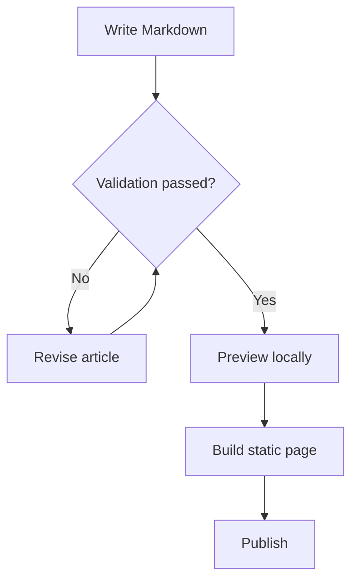

## 时序图

时序图按时间顺序呈现参与者之间的协作。这个示例跟踪了一次 Swup 导航从请求到 Mermaid 渲染的整个过程。

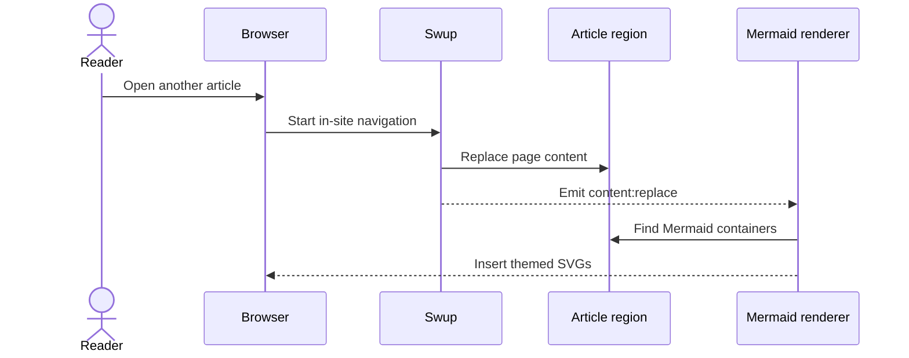

## 实体关系图

实体关系图对结构化数据以及作者、文章、标签和评论之间的联系进行建模。

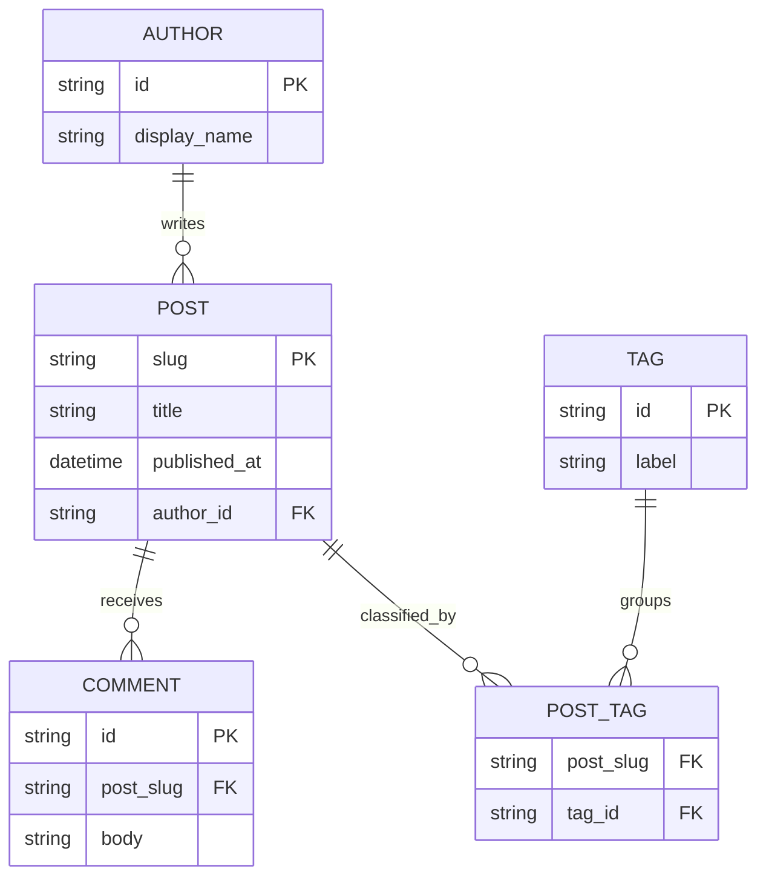

## 类图

类图表达软件设计中的职责、公开方法以及依赖方向。

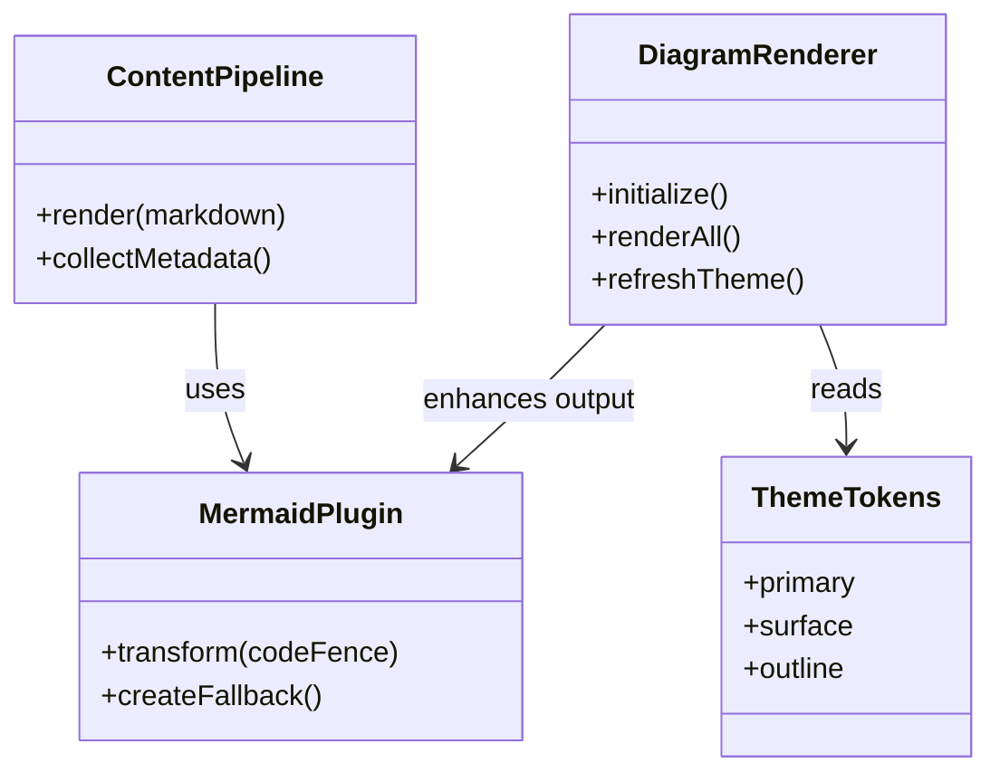

## 状态图

状态图展示对象的生命周期以及使它在状态之间移动的事件。

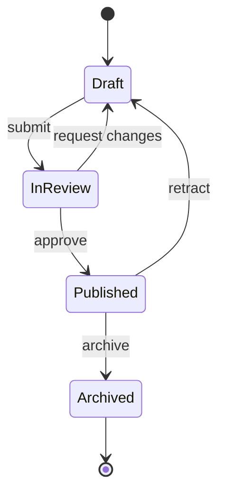

## XY 图表

XY 图表结合柱状图和折线图，在共享坐标轴上比较数值和趋势。

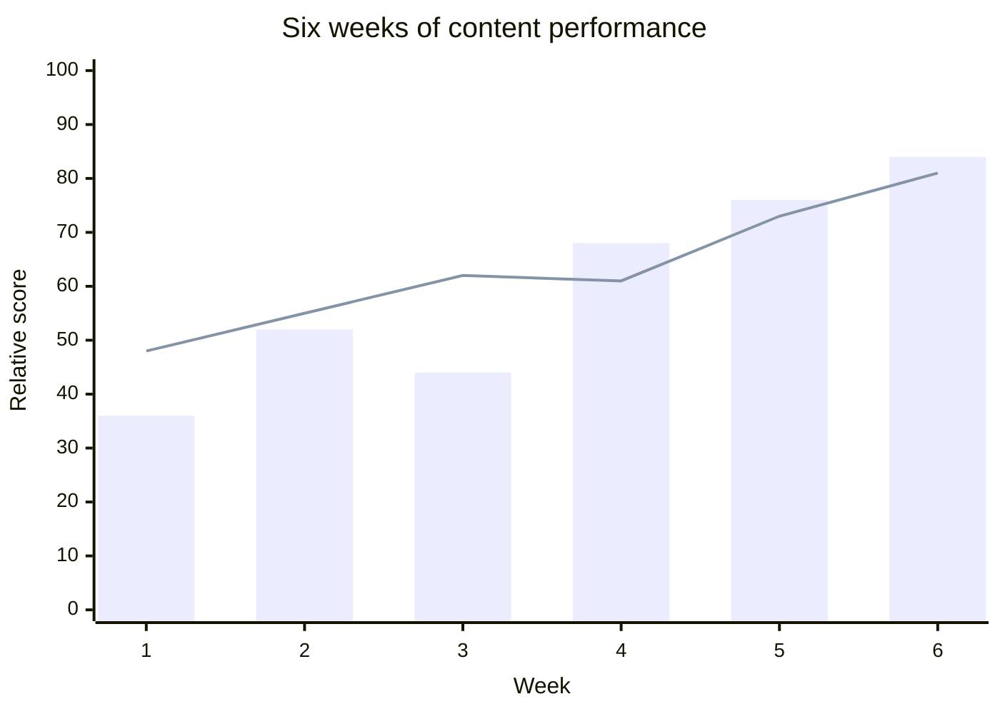

## 饼图

饼图提供了一种紧凑的比较方式，展示各个类别如何构成一个整体。

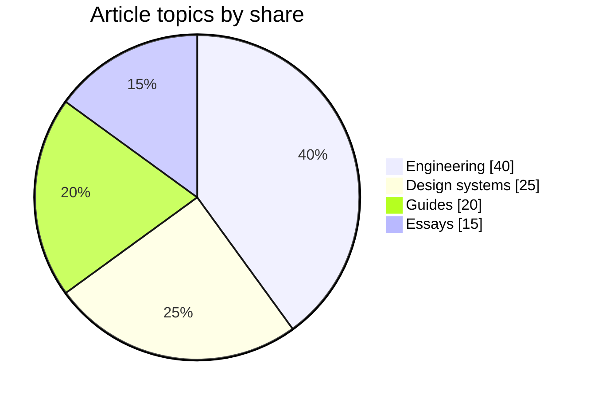

## 甘特图

甘特图将任务、依赖关系和里程碑沿日历时间轴排列。

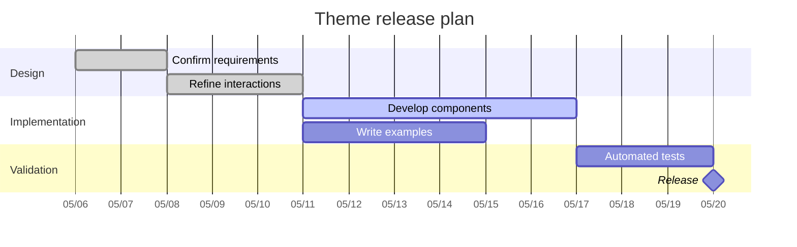

## 思维导图

思维导图将一个中心主题展开为相关的领域和支撑概念。

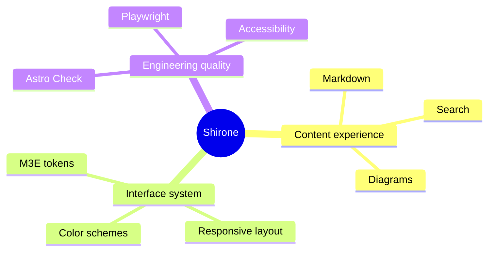

## 时间线

时间线概括重要事件或阶段，而无需精确的日历时长。

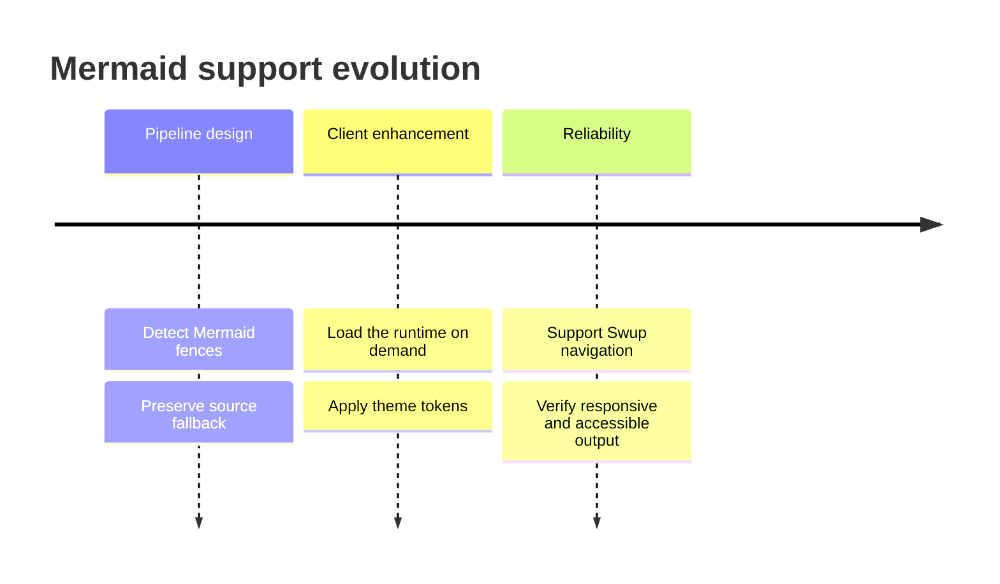

## 用户旅程

用户旅程图将任务各阶段中的动作、参与者和体验评分结合起来。

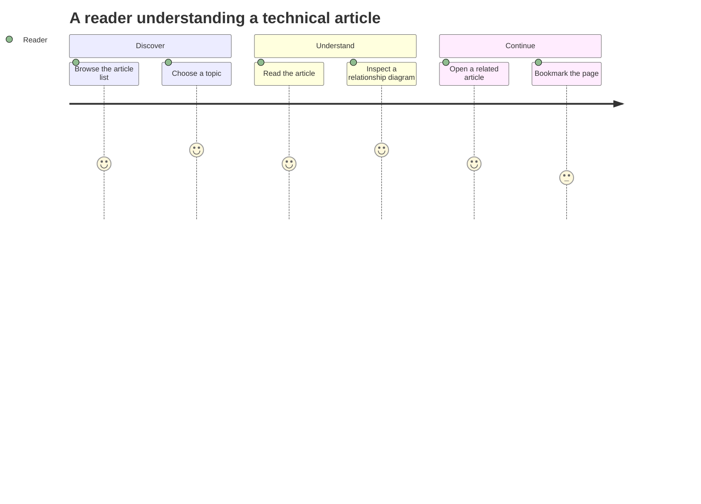

## Git 图

Git 图展示工作如何在功能分支上推进，直到它合并回主线。

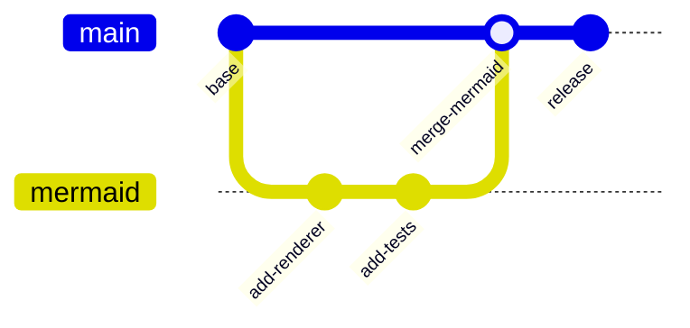

## 看板

看板按工作流状态对任务进行分组，使当前进度一目了然。

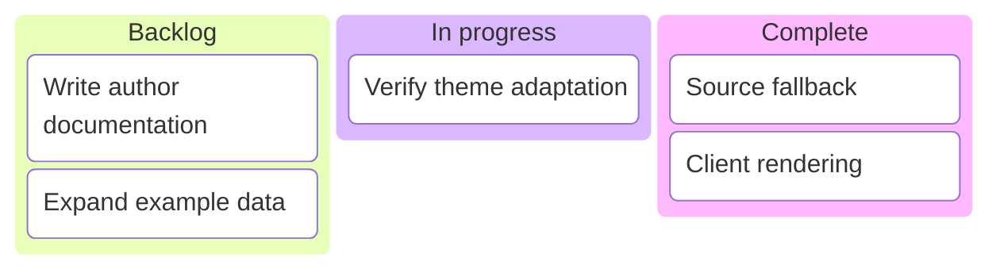

## 桑基图

桑基图使用连线宽度来展示流量或其他数量如何在节点之间流动。

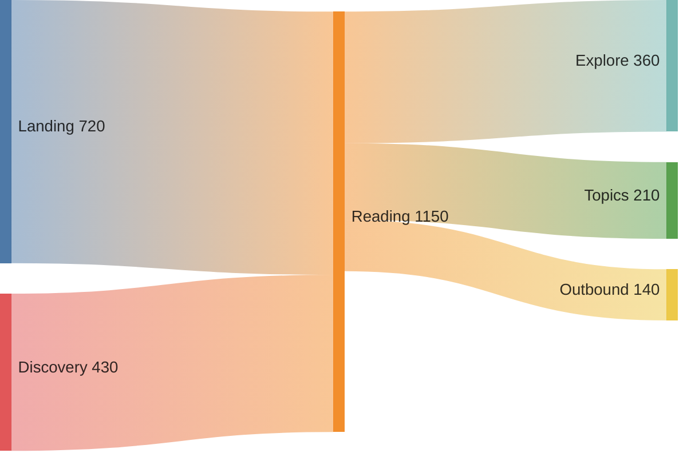

每个示例都使用标准的 `mermaid` 代码围栏。服务器保留可读的源码标记，浏览器将其增强为遵循当前主题的 SVG。当主题变化或 Swup 导航到本文时，图表会重新渲染。

---

## admonitions.md

提示框让辅助信息在视觉上更突出，同时保留文章的阅读流畅性。每一种形式都在服务器上渲染，并使用相同的紧凑 M3E 组件。

## 语义变体

::: note 部署上下文
带空格的格式接受一个普通自定义标题，同时保持与参考语法兼容。
:::

:::info
使用信息块提供中性上下文，帮助读者理解周围的小节。
:::

:::tip[现有的 **label** 语法]
原来的方括号标签仍然可用，并且可以包含行内 Markdown 强调。
:::

> [!IMPORTANT]
> GitHub Alert 语法进入同一个渲染器，因此现有文章保持统一的视觉语言。

:::warning
在运行生产构建之前，请检查环境变量。
:::

:::caution
不要随示例一起发布凭证、本地配置或私钥。
:::

## 可选详情

::: details 查看完整命令
该折叠内容使用原生浏览器语义，并且无需客户端 JavaScript 即可通过键盘访问。

```powershell
npx.cmd astro check
pnpm.cmd build
```

- 它默认处于关闭状态。
- 较长的代码可以在其自身的代码块内滚动。
- 在窄屏幕上，容器仍保持在文章宽度之内。
:::

## 编写语法

```markdown
:::note[Existing title syntax]
Content
:::

::: warning Plume-compatible title syntax
Content
:::

> [!TIP]
> GitHub Alert syntax

::: details Optional content
Hidden until the reader opens it.
:::
```

---

## collapse-panels.md

折叠面板将相关的可选详情收纳在一个紧凑的分组中。标题和正文保留行内及块级 Markdown，而原生的折叠语义让每个面板无需客户端 JavaScript 即可使用。

## 独立面板

默认情况下，各条目独立展开。在标题前加上 `:+` 可使该项初始即展开，或加上 `:-` 使该组使用 `expand` 时该项保持关闭。

::: collapse
- **包依赖要求**

  使用 Node.js 22 或更高版本，并在安装包之前启用 Corepack。

- :+ 安装依赖

  从仓库根目录运行工作区的包命令。

  ```powershell
  pnpm.cmd install
  ```

- 校验命令

  在构建生产输出之前检查内容管道。

  - `pnpm.cmd check:manifest`
  - `npx.cmd astro check`
:::

## 手风琴模式

当只应保持一个答案展开时，添加 `accordion`。浏览器会直接对原生折叠控件进行分组，因此展开另一项会关闭前一项，而无需水合。

::: collapse accordion expand
- `expand` 在这里有什么作用？

  当没有任何条目带有 `:+` 标记时，它会在初始时展开第一个条目。

- 标题可以包含 Markdown 吗？

  可以。标题支持行内 **强调** 和 `code`，而面板正文支持完整的块级 Markdown。

- 在窄屏幕上会发生什么？

  内容内边距变得更紧凑，长文本会换行，嵌入的代码保持其自身的水平滚动区域。
:::

## 编写语法

````markdown
::: collapse accordion
- :+ First title

  First panel content.

- Second title with `code`

  Second panel content.
:::
````

容器必须恰好包含一个顶层无序列表。每个条目都需要一个标题段落、一个空行以及正文内容。无效或混合的输入会保持为普通的可读 Markdown 列表。

---

## spoilers.md

剧透（Spoiler）会隐藏简短的答案或剧情细节，而不会将其从文档中移除。悬停、聚焦或激活原生控件即可显示内容。

## 行内详情

答案是 :spoiler[**42**]，而其周围的这句话仍是普通 Markdown。

剧透可以包含 `inline code` 以及 :spoiler[带 **强调** 的更长详情]。

## 编写语法

```markdown
The answer is :spoiler[42].
```

生成的 HTML 使用带有 `aria-expanded` 状态的原生按钮。在没有 JavaScript 的情况下，悬停和聚焦仍可显示文本；可选运行时会增加点击和键盘切换。

---

## marker-highlights.md

标记高亮用于突出某个特定短语，而无需把周围的段落变成独立的组件。它们在构建期间渲染为原生的 `<mark>` 元素，并继承当前激活的 M3E 色彩系统。

## 默认强调

当文章的主色应承载这种强调时，使用 `==text==`。当读者继续阅读普通段落时，用它来突出 ==一个读者应当记住的决定== 会很有用。

当短语需要更强的层级时，标记可以包含 ==嵌套的 **Markdown 强调**==。

## 语义色彩

当含义需要不同的色调角色时，使用后缀。可用的变体有 `primary`、`secondary`、`tertiary`、`error` 和 `tip`。

- ==Primary 将该短语与当前主题连接起来=={.primary}
- ==Secondary 让支撑性的区分保持低调=={.secondary}
- ==Tertiary 添加一个独立的编辑信号=={.tertiary}
- ==Error 标识需要纠正的状况=={.error}
- ==Tip 突出实用指导=={.tip}

## 编写语法

```markdown
==Primary marker==

==Secondary marker=={.secondary}
==Tertiary marker=={.tertiary}
==Error marker=={.error}
==Tip marker=={.tip}
```

诸如 `==literal marker syntax==` 这样的行内代码和围栏示例保持字面量，因此文档可以在解释语法时不触发它。

---

## steps.md

对于顺序很重要的流程，请使用步骤（Steps）。该组件保持文章的阅读流畅性不变：一条低调的编号轨道提供方向指引，而标题、段落、链接、列表和代码则保留其原生的 Markdown 角色。

## 有序列表语法

将一个 Markdown 有序列表包裹在 `:::steps` 容器中。每个顶层列表项都会成为一个步骤。

````markdown
:::steps[Production deployment]
1. **Clone and prepare the workspace**

   Clone the repository and enter the project directory.

   ```powershell
   git clone https://github.com/LyraVoid/Shirone.git
   Set-Location Shirone
   ```

2. **Install dependencies**

   Use the repository's pinned package manager.

   ```powershell
   pnpm.cmd install
   ```

3. **Run project checks**

   Confirm Astro diagnostics and TypeScript checks pass.

   ```powershell
   npx.cmd astro check
   pnpm.cmd type-check
   ```

4. **Build the production site**

   Generate the static site and search index.

   ```powershell
   pnpm.cmd build
   ```
:::
````

:::steps[生产部署]
1. **克隆并准备工作区**

   克隆仓库并进入项目目录。

   ```powershell
   git clone https://github.com/LyraVoid/Shirone.git
   Set-Location Shirone
   ```

2. **安装依赖**

   使用仓库锁定的包管理器。

   ```powershell
   pnpm.cmd install
   ```

3. **运行项目检查**

   确认 Astro 诊断和 TypeScript 检查通过。

   ```powershell
   npx.cmd astro check
   pnpm.cmd type-check
   ```

4. **构建生产站点**

   生成静态站点和搜索索引。

   ```powershell
   pnpm.cmd build
   ```
:::

## 选项

- `:::steps[Title]` 或 `title="Title"` 会添加一个可见标签和无障碍名称。
- `start=4` 会更改第一个显示的步骤编号。
- 容器必须恰好包含一个有序列表。无效或混合的输入会保持为普通的可读 Markdown，而不会被启发式地解释。
- 渲染在站点构建期间完成，不添加任何客户端 JavaScript 或网络请求。

---

## option-groups.md

选项组把等价的说明放在一起，而无需重复周围的解释。每个选项都接受完整的块级 Markdown，而选中的值可以与同一页面上的另一个组保持同步。

## 选择一个包管理器

使用 `@tab:active` 选择初始选项。`#` 后面的后缀提供一个稳定的值，而不会更改可见标题。

::: tabs#package-manager

@tab npm

使用 npm 安装该包：

```powershell
npm install astro
```

@tab:active **pnpm**#pnpm

使用 pnpm 安装该包：

```powershell
pnpm.cmd add astro
```

@tab Bun#bun

使用 Bun 安装该包：

```powershell
bun add astro
```

:::

## 运行项目

该组共享 `package-manager` id。在上方选择一个选项会更新下方匹配的命令，并记住该选择以供下次访问。

::: tabs#package-manager

@tab npm

```powershell
npm run dev
```

@tab pnpm

```powershell
pnpm.cmd dev
```

@tab Bun#bun

```powershell
bun run dev
```

:::

## 多个备选方案

较长的选项行保持在一行内，并在窄屏幕上于其自身的导航区域内滚动。

::: tabs

@tab 本地工作站

在开发某个功能时使用本地工具链。

@tab 托管预览环境

发布临时预览以供审阅。

@tab 持续集成

对每次变更运行确定性的校验。

@tab 生产部署

将经过验证的产物提升到生产环境。

@tab 离线恢复工作流

当网络不可用时，从本地产物恢复。

:::

## 编写语法

````markdown
::: tabs#package-manager

@tab npm

Use npm instructions here.

@tab:active **pnpm**#pnpm

Use pnpm instructions here.

:::
````

每个组至少需要两个 `@tab` 小节，并且每个小节都需要有正文内容，并用空行与标记分隔。无效或不完整的组会保持为普通的可读 Markdown。

---

## content-annotations.md

内容注解让辅助性上下文紧贴某个句子，而无需把它直接放进阅读流程中。激活小的注释标记即可显示其内容。

## 基本语法

在普通行文中添加一个 `[+label]` 引用，然后在同一篇文章的其他位置定义匹配的注释。

```markdown
Astro renders most of a page ahead of time and hydrates **interactive islands** [+islands] only when they need to become interactive.

[+islands]:
  An island is an interactive UI component surrounded by static HTML. This keeps the default page lightweight while preserving focused interactivity.
```

Astro 会提前渲染页面的大部分内容，并且只在需要变得可交互时才对**交互式孤岛** [+islands] 进行水合。

[+islands]:
  孤岛是被静态 HTML 包围的交互式 UI 组件。这样可以让默认页面保持轻量，同时保留聚焦的交互性。

## 富文本内容

定义可以包含段落、强调、链接、列表和行内代码 [+rich-note]，同时周围的句子继续正常书写。

[+rich-note]:
  **编写指导**

  - 让第一句话自成一体。
  - 当读者可能需要原始来源时，使用链接。
  - 优先使用简洁的示例，例如 `client:visible`。

  完整模型请参阅 [Astro islands 文档](https://docs.astro.build/en/concepts/islands/)。

## 多个定义

复用标签 [+review] 可以在一个标记后面呈现一串简短的关联注释。

[+review]: 从改变读者下一步行动的那个决定开始。
[+review]: 把实现证据与背景上下文分开。
[+review]: 删除那些本应属于正文而不是注解的细节。

诸如 `[+missing]` 这样的未定义引用保持为普通文本，因此未完成的定义永远不会创建一个空控件。

---

## expressive-code.md

在这里，我们将探索使用 [Expressive Code](https://expressive-code.com/) 时代码块的外观。所提供示例基于官方文档，如需更多详情，可参考官方文档。

## Expressive Code

### 语法高亮

[语法高亮](https://expressive-code.com/key-features/syntax-highlighting/)

#### 常规语法高亮

```js
console.log('This code is syntax highlighted!')
```

#### 渲染 ANSI 转义序列

```ansi
ANSI colors:
- Regular: Red Green Yellow Blue Magenta Cyan
- Bold:    Red Green Yellow Blue Magenta Cyan
- Dimmed:  Red Green Yellow Blue Magenta Cyan

256 colors (showing colors 160-177):
160 161 162 163 164 165
166 167 168 169 170 171
172 173 174 175 176 177

Full RGB colors:
ForestGreen - RGB(34, 139, 34)

Text formatting: Bold Dimmed Italic Underline
```

### 编辑器与终端框架

[编辑器与终端框架](https://expressive-code.com/key-features/frames/)

#### 代码编辑器框架

```js title="my-test-file.js"
console.log('Title attribute example')
```

---

```html
<!-- src/content/index.html -->
<div>File name comment example</div>
```

#### 终端框架

```bash
echo "This terminal frame has no title"
```

---

```powershell title="PowerShell terminal example"
Write-Output "This one has a title!"
```

#### 覆盖框架类型

```sh frame="none"
echo "Look ma, no frame!"
```

---

```ps frame="code" title="PowerShell Profile.ps1"
# Without overriding, this would be a terminal frame
function Watch-Tail { Get-Content -Tail 20 -Wait $args }
New-Alias tail Watch-Tail
```

### 文本与行标记

[文本与行标记](https://expressive-code.com/key-features/text-markers/)

#### 标记整行和行范围

```js {1, 4, 7-8}
// Line 1 - targeted by line number
// Line 2
// Line 3
// Line 4 - targeted by line number
// Line 5
// Line 6
// Line 7 - targeted by range "7-8"
// Line 8 - targeted by range "7-8"
```

#### 选择行标记类型（mark、ins、del）

```js title="line-markers.js" del={2} ins={3-4} {6}
function demo() {
  console.log('this line is marked as deleted')
  // This line and the next one are marked as inserted
  console.log('this is the second inserted line')

  return 'this line uses the neutral default marker type'
}
```

#### 为行标记添加标签

```jsx {"1":5} del={"2":7-8} ins={"3":10-12}
// labeled-line-markers.jsx
<button
  role="button"
  {...props}
  value={value}
  className={buttonClassName}
  disabled={disabled}
  active={active}
>
  {children &&
    !active &&
    (typeof children === 'string' ? <span>{children}</span> : children)}
</button>
```

#### 在独立行上添加长标签

```jsx {"1. Provide the value prop here:":5-6} del={"2. Remove the disabled and active states:":8-10} ins={"3. Add this to render the children inside the button:":12-15}
// labeled-line-markers.jsx
<button
  role="button"
  {...props}

  value={value}
  className={buttonClassName}

  disabled={disabled}
  active={active}
>

  {children &&
    !active &&
    (typeof children === 'string' ? <span>{children}</span> : children)}
</button>
```

#### 使用类 diff 语法

```diff
+this line will be marked as inserted
-this line will be marked as deleted
this is a regular line
```

---

```diff
--- a/README.md
+++ b/README.md
@@ -1,3 +1,4 @@
+this is an actual diff file
-all contents will remain unmodified
 no whitespace will be removed either
```

#### 结合语法高亮与类 diff 语法

```diff lang="js"
  function thisIsJavaScript() {
    // This entire block gets highlighted as JavaScript,
    // and we can still add diff markers to it!
-   console.log('Old code to be removed')
+   console.log('New and shiny code!')
  }
```

#### 标记行内的单个文本

```js "given text"
function demo() {
  // Mark any given text inside lines
  return 'Multiple matches of the given text are supported';
}
```

#### 正则表达式

```ts /ye[sp]/
console.log('The words yes and yep will be marked.')
```

#### 转义正斜杠

```sh /\/ho.*\//
echo "Test" > /home/test.txt
```

#### 选择行内标记类型（mark、ins、del）

```js "return true;" ins="inserted" del="deleted"
function demo() {
  console.log('These are inserted and deleted marker types');
  // The return statement uses the default marker type
  return true;
}
```

### 自动换行

[自动换行](https://expressive-code.com/key-features/word-wrap/)

#### 按代码块配置自动换行

```js wrap
// Example with wrap
function getLongString() {
  return 'This is a very long string that will most probably not fit into the available space unless the container is extremely wide'
}
```

---

```js wrap=false
// Example with wrap=false
function getLongString() {
  return 'This is a very long string that will most probably not fit into the available space unless the container is extremely wide'
}
```

#### 配置换行后的缩进

```js wrap preserveIndent
// Example with preserveIndent (enabled by default)
function getLongString() {
  return 'This is a very long string that will most probably not fit into the available space unless the container is extremely wide'
}
```

---

```js wrap preserveIndent=false
// Example with preserveIndent=false
function getLongString() {
  return 'This is a very long string that will most probably not fit into the available space unless the container is extremely wide'
}
```

## 可折叠区域

[可折叠区域](https://expressive-code.com/plugins/collapsible-sections/)

```js collapse={1-5, 12-14, 21-24}
// All this boilerplate setup code will be collapsed
import { someBoilerplateEngine } from '@example/some-boilerplate'
import { evenMoreBoilerplate } from '@example/even-more-boilerplate'

const engine = someBoilerplateEngine(evenMoreBoilerplate())

// This part of the code will be visible by default
engine.doSomething(1, 2, 3, calcFn)

function calcFn() {
  // You can have multiple collapsed sections
  const a = 1
  const b = 2
  const c = a + b

  // This will remain visible
  console.log(`Calculation result: ${a} + ${b} = ${c}`)
  return c
}

// All this code until the end of the block will be collapsed again
engine.closeConnection()
engine.freeMemory()
engine.shutdown({ reason: 'End of example boilerplate code' })
```

## 行号

[行号](https://expressive-code.com/plugins/line-numbers/)

### 按代码块显示行号

```js showLineNumbers
// This code block will show line numbers
console.log('Greetings from line 2!')
console.log('I am on line 3')
```

---

```js showLineNumbers=false
// Line numbers are disabled for this block
console.log('Hello?')
console.log('Sorry, do you know what line I am on?')
```

### 更改起始行号

```js showLineNumbers startLineNumber=5
console.log('Greetings from line 5!')
console.log('I am on line 6')
```

---

## 音频阅读器（Audio Reader）：日语动漫神秘声音

这些简短的日语语音片段，仿佛是从某个动漫场景的边缘截取而来：一句调皮的呼唤、一声轻快的问候、一阵小小的笑声，以及几句来历不明的台词。它们是氛围样本，而非对话转录，所以让声音来传递含义。

音频阅读器会让它们保持安静，直到你选择聆听。每个说话人按钮只有在被按下之后，才会加载并播放其音频片段。

```markdown
:audio-reader[Clip title]{src="/assets/audio/filename.wav"}
```

## 片段

- **Baka**: :audio-reader[バカ]{src="/assets/audio/Baka.wav"}
- **Ciallo**: :audio-reader[Ciallo！！]{src="/assets/audio/Ciallo.wav"}
- **Ehe**: :audio-reader[A joking sense]{src="/assets/audio/Ehe.wav"}
- **Imoi**: :audio-reader[イモい]{src="/assets/audio/Imoi.wav"}
- **Zako**: :audio-reader[雑魚じゃん、雑魚雑魚]{src="/assets/audio/Zako.wav"}

`src` 必须使用站点根路径或 HTTPS URL，且指令标签不能为空。无效或不完整的指令会保持普通 Markdown，并且不会加载音频阅读器资源。

---

## video.md

只需从 YouTube 或其他平台复制嵌入代码，然后粘贴到 Markdown 文件中即可。

```yaml
---
title: Include Video in the Post
published: 2023-10-19
// ...
---

<iframe width="100%" height="468" src="https://www.youtube.com/embed/5gIf0_xpFPI?si=N1WTorLKL0uwLsU_" title="YouTube video player" frameborder="0" allowfullscreen></iframe>
```

## YouTube

::youtube{id="5gIf0_xpFPI" title="YouTube video" preload="auto"}

## Bilibili

::bilibili{bvid="BV1fK4y1s7Qf" title="Bilibili video" p=1 preload="auto"}

## AcFun

::acfun{acid="ac48649632" title="AcFun video" preload="auto"}

## ArtPlayer

::artplayer{src="https://www.pexels.com/download/video/38538991/" title="Sintel trailer" preload="auto"}

---

## 图片画廊网格：语法与完整示例

`:::grid` 是本博客的图片画廊容器指令。它以一致的宽高比把普通 Markdown 图片排布成响应式网格，并自动启用灯箱查看。可用于文章图片、截图、作品集或小型相册。

同一画廊中的图片使用相同的卡片比例。默认情况下，居中裁剪会填满每张卡片并让每一行保持整齐；点击图片会在灯箱中打开完整原图。每个画廊都有自己独立的灯箱分组，不会与文章中的其他图片混在一起。

> 这篇文章既是功能文档，也是一个可视化测试页面。请在桌面、平板和移动宽度下查看示例，然后点击任意图片以验证灯箱分组。

## 极简语法

直接在 `:::grid` 和结束的 `:::` 之间书写 Markdown 图片：

````markdown
:::grid


:::
````

每张图片都必须占据自己的段落，图片之间用空行分隔。画廊中只保留图片；段落、列表和代码块请写在容器之外。

下面是极简语法的结果。在不带参数的情况下，网格默认使用三列、`16/10` 比例和 `cover`。

:::grid


:::

## 参数一览

把所有参数写在开头指令后面的大括号中：`:::grid{parameter="value"}`。

| 参数 | 允许的值 | 默认值 | 用途 |
| --- | --- | --- | --- |
| `columns` | `1` 到 `6` 的整数 | `3` | 桌面上每行的列数。无效值会回退为 `3`。 |
| `aspect` | 正比例，例如 `16/9`、`3/4` 或 `1/1` | `16/10` | 显示的卡片比例，而非原图比例。 |
| `fit` | `cover`、`contain` | `cover` | 图片适配模式。`cover` 裁剪以填满；`contain` 保留完整图片，可能留下空白。 |

完整示例：

````markdown
:::grid{columns="3" aspect="16/9" fit="cover"}


:::
````

下面的结果使用了上面的三列横版语法。请对比卡片比例、列数，以及标题优先于 alt 文本作为说明的方式：

:::grid{columns="3" aspect="16/9" fit="cover"}


:::

## 说明与 Alt 文本

图片的 alt 文本既用作无障碍替代文本，也用作其默认说明。当图片带有可选标题时，标题会被用作说明：

```markdown

```

在同一行中，说明会与每张卡片的底部对齐。换行的说明不会让其他卡片漂浮到不同的高度。诸如 `3:4` 和 `16:9` 这样的比例文本可以直接写在正文、标题和 alt 文本中，无需转义。

这个示例演示了默认的 alt 文本说明、显式的标题说明，以及较长说明的底部对齐：

:::grid{columns="3" aspect="1/1"}


:::

## 布局与裁剪

桌面布局使用 `columns` 指定的列数。低于 `768px` 时，网格最多使用两列；低于 `480px` 时，切换为单列。卡片包装器固定 `aspect` 比例并裁剪圆角，而图片会填满卡片，不带主题默认的图片边距。

- 选择 `cover`：推荐的默认值。图片从中心裁剪以填满卡片，使画廊看起来更一致。
- 选择 `contain`：完整显示原图而不裁剪。当其比例与卡片不同时，主题背景会保持可见；用于不能被裁剪的图片。
- 要在不留空白的情况下保留完整图片，请将 `aspect` 设置得接近原图比例，或将图片放在独立网格中。

下面的示例将相同的竖版图片放入 `16/9` 卡片中，分别使用 `cover` 和 `contain`。前者裁剪它们；后者保留完整图片并留下背景空白。

````markdown
:::grid{columns="3" aspect="16/9" fit="cover"}


:::

:::grid{columns="3" aspect="16/9" fit="contain"}


:::
````

:::grid{columns="3" aspect="16/9" fit="cover"}


:::

:::grid{columns="3" aspect="16/9" fit="contain"}


:::

## 默认配置

在不带属性的情况下，默认是三列、`16/10` 比例和 `cover` 裁剪。这三张竖版图片用于验证默认裁剪和说明。

````markdown
:::grid


:::
````

:::grid


:::

## 三列竖版：3:4

使用 `aspect="3/4"` 时，三张竖版图片会填满比例一致的纵向卡片。如果原图比例不同，`cover` 会从中心裁剪其边缘。

````markdown
:::grid{columns="3" aspect="3/4"}


:::
````

:::grid{columns="3" aspect="3/4"}


:::

## 三列横版：16:9

这一组演示了三列布局中常见的视频封面比例。当横版图片接近卡片比例时，裁剪量最小。

````markdown
:::grid{columns="3" aspect="16/9"}


:::
````

:::grid{columns="3" aspect="16/9"}


:::

## 两列方形：1:1

当需要更大的预览卡片时，两列很合适。第三张图片会移到下一行。最后一行保持其网格轨道宽度，而不是拉伸图片来填满整行。

````markdown
:::grid{columns="2" aspect="1/1"}


:::
````

:::grid{columns="2" aspect="1/1"}


:::

## 使用 `contain` 的四列

`fit="contain"` 不会裁剪原图。当图片比例与卡片比例不同时，主题背景会保持可见。这是有意为之，而非布局问题。它同时也验证了四列网格与独立的灯箱分组不会相互干扰。

````markdown
:::grid{columns="4" aspect="16/9" fit="contain"}


:::
````

:::grid{columns="4" aspect="16/9" fit="contain"}


:::

## 单列细节图片

当图片需要更大的阅读尺寸时，单列很合适。它在桌面、平板和移动端都保持单列，并且灯箱中仍然可以查看原图。

````markdown
:::grid{columns="1" aspect="16/9"}

:::
````

:::grid{columns="1" aspect="16/9"}

:::

## 稀疏的五列行

五列用于验证更高的受支持列数。在只有三张图片的情况下，最后一行会保持左对齐，而不是拉伸图片。

````markdown
:::grid{columns="5" aspect="1/1"}


:::
````

:::grid{columns="5" aspect="1/1"}


:::

## 六列混合图片

六列是当前的最大值。混合横版和竖版图片可以验证 `cover` 裁剪、窄卡片上的说明，以及密集的桌面布局。对于可读的文章内容，通常两到四列更合适。

````markdown
:::grid{columns="6" aspect="1/1"}


:::
````

:::grid{columns="6" aspect="1/1"}


:::

## 四列方形：1:1

四张比例相同的方形图片是典型的四列布局。桌面端在一行内显示全部四张；平板端折叠为两列，移动端为一列。

````markdown
:::grid{columns="4" aspect="1/1"}


:::
````

:::grid{columns="4" aspect="1/1"}


:::

## 六列横版：16:9

六列横版非常适合缩略图预览、作品集和截图索引。即使原图比例略有不同，`cover` 也能一致地填满每张 `16/9` 卡片。

````markdown
:::grid{columns="6" aspect="16/9"}


:::
````

:::grid{columns="6" aspect="16/9"}


:::

## 三列竖版：3:4

这组六张竖版图片演示了人物、海报或移动端截图常见的布局。图片排成两行、每行三张，说明与底部对齐。

````markdown
:::grid{columns="3" aspect="3/4"}


:::
````

:::grid{columns="3" aspect="3/4"}


:::

## 边缘关键内容：`cover` 与灯箱

这些图片在靠近边缘处包含重要的文字或细节。`cover` 能保持网格整齐，但可能会裁剪掉这些边缘；点击图片即可在灯箱中查看未经裁剪的原图。对于边缘敏感型图片，请使用清晰的说明，或者使用下面的 `contain`。

````markdown
:::grid{columns="3" aspect="16/9" fit="cover"}


:::
````

:::grid{columns="3" aspect="16/9" fit="cover"}


:::

## 使用 `contain` 的极端比例

对于横幅、长截图和其他极端图片比例，`contain` 会显示完整的原图。与 `cover` 不同，它可能留下主题背景空白，但绝不会裁剪内容。

````markdown
:::grid{columns="3" aspect="16/9" fit="contain"}


:::
````

:::grid{columns="3" aspect="16/9" fit="contain"}


:::

## 透明图片

透明图片会显露出卡片的主题背景。这个单列 `contain` 示例便于检查透明区域、原始边缘以及灯箱行为。

````markdown
:::grid{columns="1" aspect="16/9" fit="contain"}

:::
````

:::grid{columns="1" aspect="16/9" fit="contain"}

:::

## 灯箱导航

点击网格中的任意图片即可打开 Fancybox 灯箱。在那里你可以缩放、旋转、进入全屏、查看缩略图，并用方向键导航。导航仅限于当前的 `:::grid` 容器：例如，点击"16:9 测试图片一"只会打开该节中的另外两张横版图片。

同一篇文章中的普通 Markdown 图片仍然会被单独处理；它们不会被添加到任何网格画廊中。

## 检查清单

1. 每个网格中的图片尺寸一致，卡片下方带有说明。
2. 悬停时图片会轻微缩放；点击后可以缩放、旋转并用键盘导航。
3. 点击"16:9 测试图片一"时，灯箱只会浏览该节中的另外两张横版图片。
4. 低于 768px 时，网格最多使用两列；低于 480px 时，使用单列。
5. "使用 `contain` 的四列"中的竖版图片完全可见，留有空白且不裁剪。
6. 五列和六列网格在宽屏上保持其指定列数，然后根据响应式规则折叠为两列或一列。

---

## encrypted-demo.md

# 密码保护的文章

恭喜！你已经成功解锁了这篇加密文章。浏览器使用 **Web Crypto API（AES-256-GCM + PBKDF2）** 在本地解密了这份预编译内容。

---

## 1. 安全架构与核心特性

Shirone 的文章加密系统与受保护相册共享统一的安全基础，为静态发布提供企业级安全性：

1. **静态 HTML 构建中的零明文**  
   在 Astro SSG 构建管道中，文章 Markdown 被编译为 HTML，并在输出页面前立即使用 AES-256-GCM 加密。发布的静态 HTML 中，受保护正文或大纲的**明文为零**。

2. **带 AAD 作用域绑定的认证加密**  
   - 密钥派生遵循 OWASP 建议，采用 **310,000 次 PBKDF2 迭代**（SHA-256）以及加密随机的 16 字节盐；
   - 每个加密载荷都会生成一个独立的 12 字节随机 IV；
   - **附加认证数据（AAD）** 绑定 `shirone-protected-content:1:post:${slug}` 确保密文无法在不同文章或相册之间被重放。

3. **会话持久化与零磁盘密码存储**  
   - 解密后的内容缓存在临时的浏览器会话存储中，30 分钟后过期；
   - 明文密码绝不会写入磁盘或存储；
   - 在同一会话中，解密状态可无缝地在 Swup 客户端导航和页面刷新之间保持。

4. **全站防泄露**  
   - **搜索索引**：静态页面不含明文，防止搜索引擎和 Pagefind 索引私有内容；
   - **RSS 订阅源**：受保护文章在订阅源中输出本地化占位符，防止 RSS 聚合器抓取敏感文本；
   - **卡片摘要与字数**：当配置 `hideHomeContent: true` 时，索引和归档卡片上的描述和字数会被遮罩；
   - **目录（TOC）**：标题层级在解锁前保持隐藏，并在解密时动态重建并与 M3E 样式同步。

> 💡 **演示提示**：这篇演示文章的默认解锁密码是 `shirone-secret`。

---

## 2. 交互式富内容演示

文章解密会与运行时辅助函数协调，动态挂载语法高亮、代码折叠、交互式 Mermaid 图表、LaTeX 公式和图片灯箱。

### 2.1 代码块与语法高亮

下面的代码块测试了 Expressive Code 的语法高亮、复制操作和行装饰：

```typescript
import { decryptProtectedContent, type ProtectedPayload } from "@/utils/password-protection";

/**
 * Client-side post decryption example
 */
async function unlockArticle(payload: ProtectedPayload, password: string): Promise<string> {
    const scope = payload.scope;
    console.log(`[Shirone] Decrypting scope: ${scope}`);
    
    // Execute AES-256-GCM decryption with AAD verification
    const decryptedHtml = await decryptProtectedContent(payload, password, scope);
    console.log("[Shirone] Decryption successful, length:", decryptedHtml.length);
    return decryptedHtml;
}
```

```bash
# Verify build and type checking
npx.cmd astro check
pnpm.cmd type-check
pnpm.cmd test
```

### 2.2 Mermaid 架构图

下面的流程图通过 Mermaid 渲染，并在解密时动态绑定：

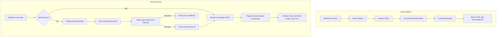

### 2.3 LaTeX 数学公式

行内公式：欧拉恒等式 $e^{i\pi} + 1 = 0$ 和高斯积分 $\int_{-\infty}^{\infty} e^{-x^2} dx = \sqrt{\pi}$。

使用水平滚动容器显示数学公式：

$$
f(x) = \frac{1}{\sigma \sqrt{2\pi}} \exp\left( -\frac{(x - \mu)^2}{2\sigma^2} \right)
$$

$$
\mathcal{L}_{\text{AES-GCM}} = \text{GHASH}_H(A \parallel C \parallel L) \oplus \text{AES}_K(J_0)
$$

### 2.4 提示框

:::note 架构说明
该加密系统遵循原子设计原则和最小补丁约定，同时不损害 SSR 稳定性。
:::

:::tip 主题集成
解锁后，尝试在浅色和深色模式之间切换，或更改主色调；解密后的组件会动态适应当前激活的设计令牌。
:::

:::important 安全范围
静态客户端加密旨在防止未授权的浏览和自动化索引。对于关键任务级的商业机密，建议使用服务端身份认证。
:::

:::warning 密码找回
静态加密没有集中式服务器数据库。如果密码被遗忘，加密内容将无法恢复。
:::

### 2.5 GitHub 仓库卡片

::github{repo="withastro/astro"}

---

## 3. 配置参考

| 参数 | 类型 | 必填 | 默认值 | 说明 |
| :--- | :--- | :--- | :--- | :--- |
| `encrypted` | `boolean` | 否 | `false` | 显式将文章标记为加密。若设置了 `password`，则隐式为 `true`。 |
| `password` | `string` | 是 | 无 | 用于构建时加密、运行时解锁的明文密码。 |
| `passwordHint` | `string` | 否 | `""` | 显示在密码输入框下方的可选提示。 |
| `hideHomeContent` | `boolean` | 否 | `true` | 在索引卡片、归档和 RSS 订阅源中隐藏文章描述和字数统计。 |

---

## 4. 总结

本演示验证了 Shirone 中完整的加密生命周期：静态输出中的零明文、稳健的加密校验、跨导航和页面刷新的会话持久化，以及动态的运行时再水合。
